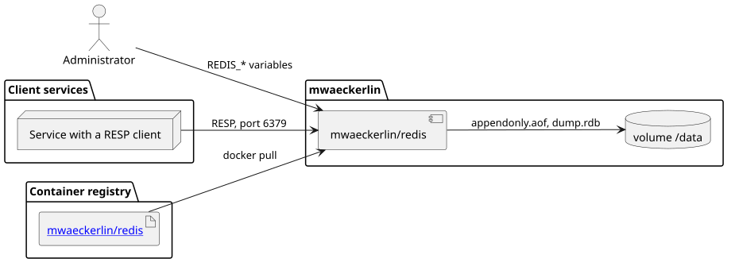
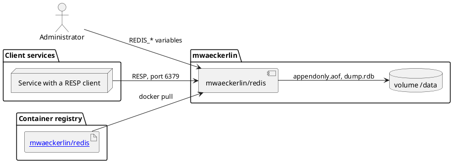
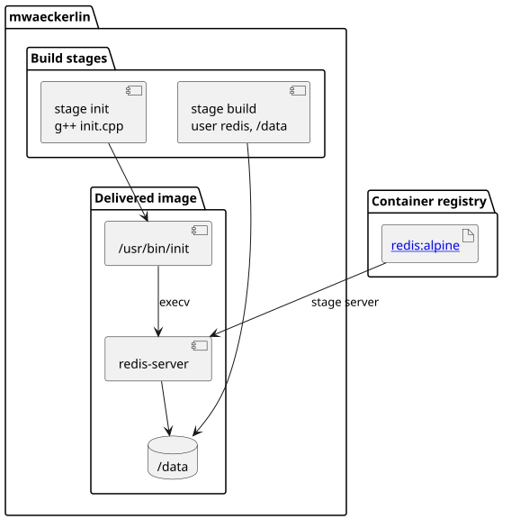
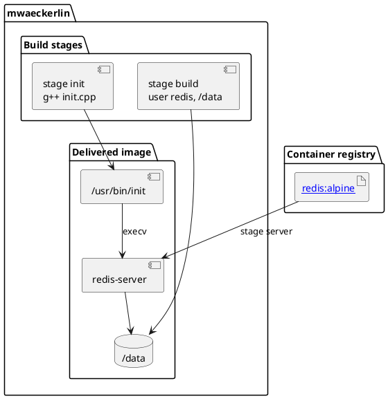
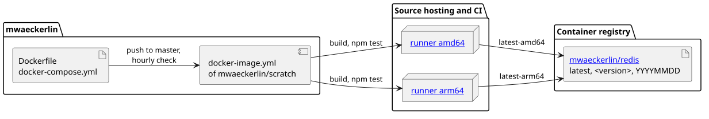
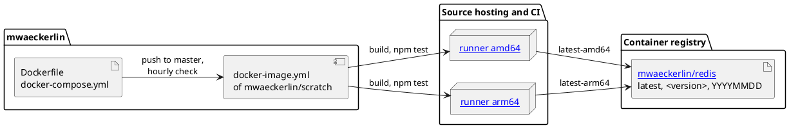

# mwaeckerlin/redis architecture

| Entry | Value |
| --- | --- |
| Subject | Image `mwaeckerlin/redis`, its configuration and its build |
| Reader | Administrator, developer |
| Basis | Source, [FEATURES.md](FEATURES.md) and [TESTS.md](TESTS.md) of this repository |
| Date | 2026-10-30 |

## 1. Introduction and Goals

The image runs a key-value server for the services of a Docker network, configured through environment variables at the start of the container.

### 1.1 Requirements overview

The server answers on port 6379 (F1), keeps every change on the volume `/data` (F2), asks for a password when one is set (F3), limits its memory on demand (F4), and loads the snapshots of the current upstream release (F10). Every variable is validated before the configuration is written (F5). The image is [headless](#headless), carries its own health check and runs as `redis`, uid 102 (F6, F8, F9); it is published for amd64 and arm64 (F7) and its compose file publishes the port on every address of the host unless `BIND_ADDRESS` names one (F11).

### 1.2 Quality goals

| Priority | Goal | Meaning here |
| --- | --- | --- |
| 1 | Durability | A restart of the container loses no stored value |
| 2 | Security | No shell and no client in the image, no value that adds a directive |
| 3 | Compatibility | The snapshots of the current upstream release load |

### 1.3 Stakeholders

| Role | Expectation |
| --- | --- |
| Administrator | Sets the variables, persists `/data`, relies on the health check |
| Client service | Speaks the RESP protocol on port 6379 |
| Developer | Changes the image and runs `npm test` |

## 2. Architecture Constraints

The constraints come from the image family and from the upstream release.

### 2.1 Technical constraints

The delivered image starts from the [runtime base](#runtime-base) and has no shell, so a compiled program, `init.cpp`, writes `redis.conf` at start. The package of the [package distribution](#package-distribution) lags behind the upstream release and cannot load its snapshots, so `redis-server` is taken from the official image `redis:alpine` on the [container registry](#container-registry).

### 2.2 Organisational constraints

The rules of the image family apply to every image of this repository: `master` is the only branch, a version number is never written into a Dockerfile, a setting of the operator is an environment variable with a default, and every image is built and published by the reusable workflow `docker-image.yml` of `mwaeckerlin/scratch`.

## 3. Context and Scope

The image is one container on the network of the services that use it.

### 3.1 Business context

PlantUML source

### 3.2 Technical context

| Interface | Protocol or form | Direction | Features |
| --- | --- | --- | --- |
| Port 6379 | RESP | in | F1, F3, F4 |
| Environment at start | `REDIS_*` variables | in | F1 to F5 |
| Volume `/data` | append-only file and snapshots | in and out | F2, F10 |
| Health check | `/usr/bin/init --healthcheck` | out | F8 |

## 4. Solution Strategy

- `init` validates every `REDIS_*` variable, writes `/run/redis/redis.conf` and starts `redis-server` with `execv`.
- `redis-server` and its libraries are copied out of the official image into the [runtime base](#runtime-base); no client and no helper goes with it.
- The same program answers the health check with `AUTH` and `PING`, so the image needs no client for it.

## 5. Building Block View

The building blocks are the stages of the Dockerfile and what they leave in the delivered image.

### 5.1 Whitebox of the image

PlantUML source

| Block | Responsibility | Source |
| --- | --- | --- |
| `init` | Validates the variables, writes `redis.conf`, starts the server, answers the health check | `init.cpp` |
| `redis-server` | Stores and serves the values | [key-value server software](#key-value-server) |

## 6. Runtime View

The runs below are the ones the e2e tests walk.

### 6.1 Start

1. `init` reads `REDIS_BIND`, `REDIS_PORT`, `REDIS_PASSWORD` or the file `REDIS_PASSWORD_FILE` names, `REDIS_APPENDONLY`, `REDIS_SAVE`, `REDIS_MAXMEMORY` and `REDIS_MAXMEMORY_POLICY` and stops with `invalid <VARIABLE>` on a malformed value.
2. It writes `/run/redis/redis.conf` and starts `redis-server` on it, which loads `/data`.

### 6.2 Health check

Every 30 seconds Docker runs `/usr/bin/init --healthcheck`, which sends `AUTH` when a password is set and `PING`, and reports healthy only on `PONG`.

## 7. Deployment View

The image is built and published by the workflow of the family and runs as one container.

### 7.1 Build and publication

A push to `master`, a manual start and the hourly check start `.github/workflows/docker.yml`, which calls the reusable workflow `docker-image.yml` of `mwaeckerlin/scratch`. The workflow builds every image of the compose file on one runner of the [source hosting and CI](#source-hosting) per architecture, amd64 and arm64, runs `npm test` there, pushes the tested image under an architecture tag to the [container registry](#container-registry) and then joins the architectures under the tags `latest`, `YYYYMMDD`, `<version>` and `<version>-YYYYMMDD`, the version read from `package.json`. The hourly check builds only when a parent image or a download changed, or when the published image is a week old.

PlantUML source

### 7.2 Operation

| Element | Value |
| --- | --- |
| Port | 6379, published by the compose file of this repository on every address of the host, or on `BIND_ADDRESS` where it names one; a stack whose clients use the Docker network publishes none |
| Volume | `/data`, owned by uid 102 |
| User | `redis`, uid 102 |
| Network | the network of the client services |
| Secret | `REDIS_PASSWORD` in the environment, or a file such as a Docker secret named by `REDIS_PASSWORD_FILE`; both empty by default |

## 8. Cross-cutting Concepts

The concepts below apply to every building block.

### 8.1 Security

Every value is checked against what its directive accepts before `redis.conf` is written, so a line break cannot add a directive (F5). The image carries no shell, no `redis-cli` and no package manager.

### 8.2 Tests

`npm test` runs the docs contract, the compose contract, the image contract, the configuration validation and the e2e suite of `tests/run.sh`, which uses the official image only as client. [TESTS.md](TESTS.md) lists every test with its feature.

## 9. Architecture Decisions

The decisions below shape the Dockerfile and the init.

### 9.1 Server from the official image

The package of the [package distribution](#package-distribution) refused the snapshot format 15 that the current upstream release writes, so the server comes from `redis:alpine` (F10). The family takes the base images of build stages from `mwaeckerlin`; this stage is the exception, open in [TODO.md](TODO.md).

### 9.2 No memory limit by default

`REDIS_MAXMEMORY` is empty, because a default limit would make legitimate writes fail; the eviction policy stands ready for the moment a limit is set.

## 10. Quality Requirements

The scenarios below are measured by the tests named.

### 10.1 Quality scenarios

| Scenario | Expected result | Test |
| --- | --- | --- |
| The container restarts | the stored value is read back | `tests/run.sh` › aof_persistence_across_restart |
| A command without `AUTH` on a server with password | refused | `tests/run.sh` › auth_required_without_password |
| A snapshot of the upstream release lies in `/data` | it loads | `tests/run.sh` › loads_snapshot_of_redis_latest |
| A password with a line break | the container stops | `tests/config-validation.sh` |
| The password lies in a Docker secret | clients authenticate with it, the health check passes | `tests/run.sh` › auth_with_password_file, healthcheck_with_password_file |

## 11. Risks and Technical Debt

Where an operator decides a risk, the README names it as well.

### 11.1 Foreign build stage base

The server depends on the official image on the [container registry](#container-registry); the hourly check rebuilds when its digest changes.

### 11.2 Password in the environment

`REDIS_PASSWORD` is readable by `docker inspect`. `REDIS_PASSWORD_FILE` names a file, such as a Docker secret, whose content `docker inspect` does not show.

## 12. Glossary

The terms of this document and the providers of its external dependencies.

### 12.1 Terms

| Term | Meaning |
| --- | --- |
| Headless | The delivered image carries no shell, no interpreter and no package manager, only the program it runs and its libraries |
| Build stage | A `FROM` stage of the Dockerfile that compiles or collects files and is not part of the delivered image |
| Runtime base | `mwaeckerlin/scratch`, the empty image with the users of the family that every delivered image of the family starts from |

### 12.2 Logical designations

The external dependencies stand under their function in this document; the table names who provides them.

| Logical designation | Description | Company in the UK | Company in Switzerland |
| --- | --- | --- | --- |
| Source hosting and CI | Holds the git repository and runs the workflow on its runners for amd64 and arm64 | GitHub, Inc. | GitHub, Inc. |
| Container registry | Serves the published images and the parent images a build pulls | Docker, Inc. | Docker, Inc. |
| Key-value server software | The program `redis-server`, taken from the official image `redis:alpine` | Redis Ltd. | Redis Ltd. |
| Package distribution | Delivers the packages that `$PKG_INSTALL` installs in the build stages on `mwaeckerlin/very-base` | Alpine Linux project, no company | Alpine Linux project, no company |
